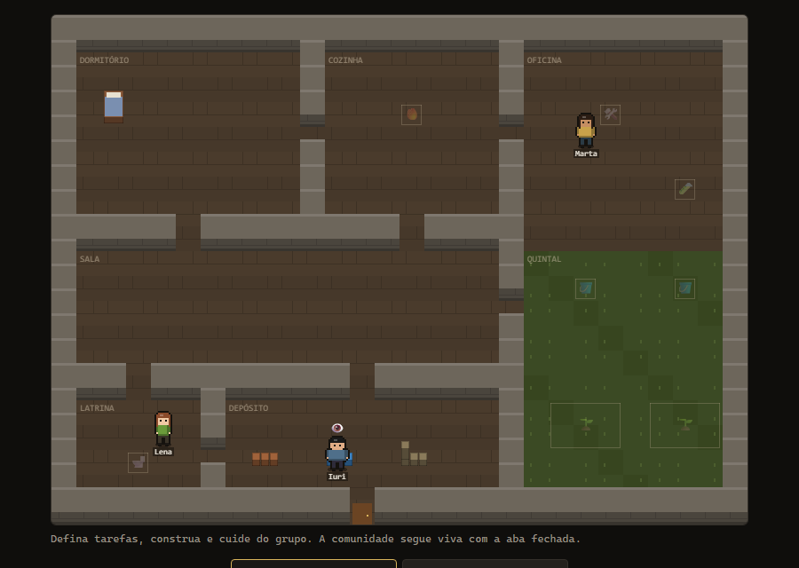
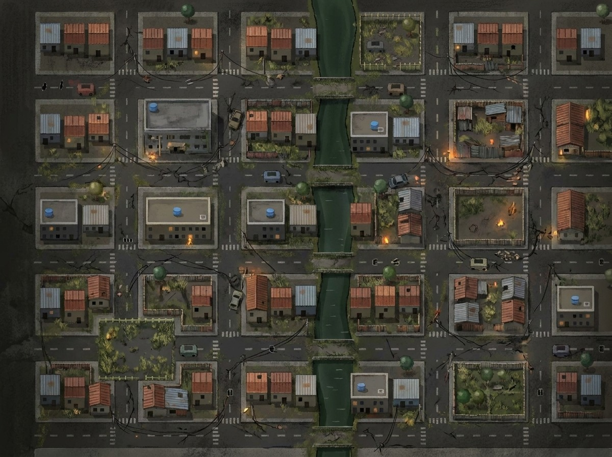
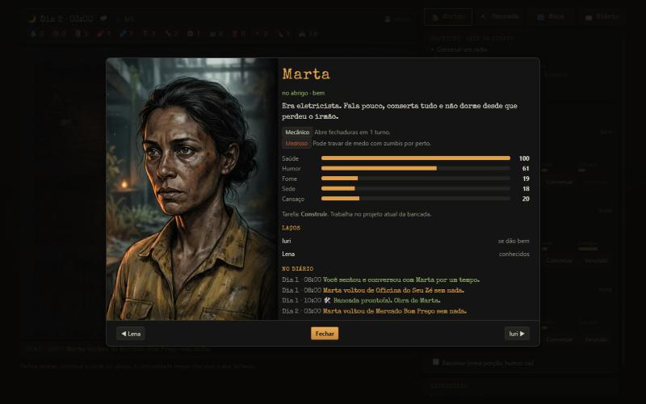
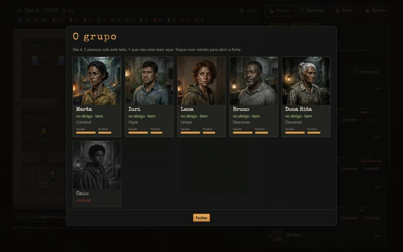
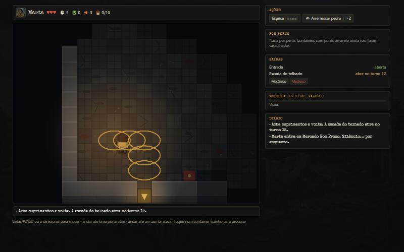

# Lads Remnants

Idle de sobrevivência num apocalipse zumbi, com incursões táticas por turnos. Visão completa em [docs/vision.md](docs/vision.md).

**Jogar:** https://ladnav.github.io/lads-remnants/ (no celular, dá para instalar pela opção "Adicionar à tela inicial"). Com `?offline` no fim do endereço o abrigo fica salvo só no navegador.

## Rodar
```bash
npm install
npm run dev       # http://localhost:5173
npm test          # testes da simulação (Vitest)
npm run balance   # simula 45 dias de comunidades (AFK x jogador casual)
npm run build
npm run deploy:edge   # empacota src/server e publica a Edge Function "game"
npm run smoke:online  # teste ponta a ponta contra o Supabase
npm run art           # gera a arte que falta pela API do Gemini (gasta créditos)
npm run art -- --cost # só mostra quanto já foi gasto
npm run deploy:pages  # faz o build e publica no GitHub Pages (ramo gh-pages)
```

| Abrigo | Mapa da região |
|---|---|
|  |  |

| Ficha de personagem | Grupo | Incursão |
|---|---|---|
|  |  |  |

### Online x offline
Com `VITE_SUPABASE_URL` e `VITE_SUPABASE_ANON_KEY` no `.env.local`, o jogo roda **online**: login anônimo e o servidor como autoridade. Sem essas variáveis, ou com `?offline` na URL, roda **offline** com as mesmas regras e save no navegador.

O `.env.local` (fora do git) guarda também a senha do banco e o ref do projeto (`tlvymkqlpyrdubdlhohn`, região sa-east-1).

## Estrutura
- `src/sim/`: simulação pura e determinística (sem Phaser).
  - `raid/`: incursão tática. Mapa gerado por semente, ruído, horda, mochila, combate, extração. Semente + log de ações reproduzem a partida.
  - `shelter/`: abrigo idle. Tick de 1h de jogo com necessidades, emoções, construção, expedições noturnas, visitantes na porta e ataques de madrugada.
- `src/data/`: itens, recursos, receitas, locais, traços e sobreviventes.
- `src/game/`: cenas Phaser (abrigo, mapa da região e incursão), HUDs e save local.
  - `sprites.ts`: personagens desenhados por código. `icons.ts`: ícones em pixel art no lugar de emojis.
  - `night.ts`: noite com focos de luz e chuva. `sound.ts`: som sintetizado com WebAudio.
  - `art.ts`: endereços da arte pintada em `public/art/`.
- `scripts/art.mjs`: gera a arte pintada. Originais em `art/raw/`, versões leves em `public/art/`, custo em `art/ledger.json`.
- `src/server/game.ts`: regras de servidor (comandos, ingressos de incursão, reprodução do log de ações). Rodam no navegador (offline) e na Edge Function (online).
- `src/net/`: backends local e Supabase.
- `supabase/`: migração (tabela `shelters` com RLS só de leitura), Edge Function `game` e config de auth.
- `src/main.ts`: relógio em tempo real, troca abrigo ↔ incursão, relatório "enquanto você esteve fora".
- `scripts/balance.ts`: balanceamento automático.

## Status
- **Fase 1**: incursão tática jogável.
- **Fase 2**: abrigo idle jogável, com save no navegador. 1 dia de jogo = 12h reais; os botões 60×/600×/+1h/+6h servem para testar.
- **Fase 3**: integração completa.
  - Mapa da região com 5 locais. Só 2 são conhecidos no início; os outros são revelados por 🗺️ mapas rabiscados, achados apenas em incursões ativas.
  - Incursão ativa em qualquer local conhecido, com loot e quantidade de zumbis próprios.
  - Emergências: uma expedição noturna pode ficar encurralada. O jogador assume o controle (incursão em modo emergência, com a horda já acordada) ou deixa com a IA.
  - Relatório de retorno com o saldo de recursos, quem morreu ou partiu e quem chegou.
- **Visual 3/4** no abrigo, no mapa e na incursão (câmera seguindo o sobrevivente).
- **Fase 4**: backend no Supabase.
  - Login anônimo, com opção de vincular e-mail depois.
  - O servidor é a autoridade: o cliente só manda comandos e a tabela é só leitura para o jogador.
  - A simulação avança de forma preguiçosa a cada acesso (determinística, sem cron).
  - Incursões com ingresso: a semente vem do servidor e o loot sai da reprodução do log de ações. Fechar a aba no meio conta como fuga ferida.
  - `ALLOW_DEV_TOOLS` (secret da função) libera +1h/+6h no modo online. Está em `false` desde a publicação; para testar, `supabase secrets set ALLOW_DEV_TOOLS=true --project-ref <ref>`.
- **Fase 4b**: avisos no celular.
  - O banco chama a função `tick` a cada 15 minutos (pg_cron). Ela avança o abrigo de quem pediu avisos e manda um web push quando batem na porta, numa emergência, numa perda, quando a expedição volta ou quando a comunidade acaba. No máximo um aviso por vez, o mais urgente.
  - As regras ficam em `tickShelter` (`src/server/game.ts`), testadas em `tests/push.test.ts`.
  - O jogador liga os avisos na aba Diário. No iPhone só funciona com o jogo instalado na tela de início.

- **Revisão de mecânicas**:
  - Incursão ativa: uma por dia por sobrevivente, recusada com cansaço alto, e o loot do mapa segue o estoque do local. Um mapa rabiscado por local.
  - Equipamento: dá para levar arma e até 2 bandagens do estoque. Voltam se o sobrevivente voltar.
  - Combate: três tipos de zumbi (comum, corredor, brutamontes) e 2 pedras por incursão para distrair (T).
  - Ordens permanentes: repetir uma expedição toda noite e fila de construção.
  - Modo de espera: após 24h reais sem comando, o grupo consome menos e ninguém bate na porta.
  - Emergência: o encurralado aguenta 12h reais além da volta do grupo.

- **Repaginação visual**:
  - Arte pintada, gerada no Gemini com um estilo fixo: retratos dos oito sobreviventes, ilustração dos cinco locais, telas de abertura, visitante, invasores e finais, e os cenários do abrigo e do mapa.
  - Os cenários são pintados **sobre a planta exata do jogo** (`scripts/art-ref-shelter.mjs` desenha a do abrigo), então paredes, portas e caminhos não mudam. No abrigo, as paredes são recortes da própria pintura, para as pessoas passarem atrás delas. Se a pintura não carregar, o abrigo volta a ser desenhado por código.
  - No mapa, cada local é um cartão com a foto do lugar preso ao ponto.
  - Personagens desenhados por código com formas arredondadas (galeria em `?sprites`); ícones próprios em pixel art.
  - Noite escura com focos de luz que tremem, chuva, e a incursão iluminada pela lanterna de quem entrou.
  - Jogo desenhado em 3× a resolução lógica.
- **Painel**: barra de status sempre à vista, quatro abas (Abrigo, Bancada, Mapa, Diário), ficha de personagem e tela do grupo.
- **Celular**: uma coluna, abas embaixo, câmera próxima que anda com o dedo no abrigo e no mapa, e direcional na incursão.
- **Som**: ambiente (vento, chuva, zumbido dentro dos prédios) e efeitos, sintetizados na hora, com botão de mudo no canto do jogo.
- **Relações**: cada par de sobreviventes tem um laço que cresce com trabalho lado a lado, jantar na mesa e expedições juntos, e azeda com fome e mau humor. Amigos (💛) rendem mais na mesma tarefa, se protegem em expedição, seguram o humor e a deserção, e sofrem mais com a morte um do outro. Desafetos (⚡) fazem o contrário.
- **Objetivo**: sair da cidade. Construir o rádio, decifrar a transmissão (36h de escuta noturna, sozinho) e juntar 6 de combustível mais comida e água para a estrada. Partir encerra a história com quem estiver vivo.

Balanceamento atual (`npm run balance`, 40 sementes, até 45 dias): sem nenhuma visita, a comunidade dura cerca de 7 dias de jogo. Com uma única visita deixando ordens permanentes, cerca de 17 dias (8 dias reais). Um jogador casual simulado (2 visitas por dia, duas expedições por noite, sem incursões ativas) dura cerca de 29 dias, e só 1 em 40 consegue partir: sem incursões ativas faltam peças para o rádio.

- **Primeiros minutos**: cartão "Primeiros passos" com seis passos guiados (bancada, porta, conversa, expedição, incursão, água), com um ponto na aba para onde ir. A primeira visita bate na porta 2h de jogo depois do começo (1h real), sem depender de sorte.
- **Métricas**: as funções gravam em `play_events` aberturas do jogo, comandos, incursões, fim da história e recomeço. `npm run metrics` mostra o resumo: jogadores, quem voltou no dia seguinte e depois de uma semana, incursões, mortes e saídas da cidade.

### Publicar os avisos no servidor
Passos que mexem em produção e por isso são feitos à mão, uma vez:
```bash
npm run vapid -- --secrets                                             # gera as chaves (se faltarem) e escreve .push-secrets.env
supabase secrets set --env-file .push-secrets.env --project-ref <ref>  # chaves e contato para a função tick
rm .push-secrets.env
supabase db push                                                       # tabelas push_subscriptions e tick_state, e o agendamento
npm run deploy:edge                                                    # função game com o pacote novo
supabase functions deploy tick --no-verify-jwt                         # função do agendador
npm run deploy:pages                                                   # site com o botão de avisos
```
O build do site precisa de `VITE_VAPID_PUBLIC_KEY` no `.env.local` (gravada pelo `npm run vapid`).

### Gasto com arte
Cada chamada paga à API fica em `art/ledger.json`, com tokens e custo estimado pela tabela do Google. O script para de gerar ao chegar em `ART_BUDGET_USD` (padrão US$ 6, no `.env.local`). A API não informa saldo: o valor real está no painel do Google. Os próximos passos estão em [docs/ROADMAP.md](docs/ROADMAP.md).

Controles da incursão: setas/WASD movem. Andar até uma porta abre, andar até um zumbi ataca. E procura, Espaço espera, X extrai, P/F abrem ou forçam portas trancadas, B faz curativo.
